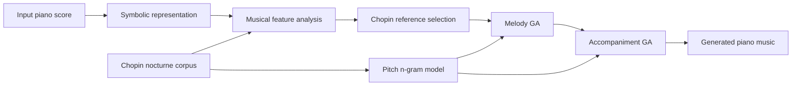

# Music Style Transfer to Chopin Nocturne Style Using Genetic Algorithms

An undergraduate capstone project on **symbolic piano music style transfer** using a two-stage Genetic Algorithm (GA). The project investigates how an input piano piece can be transformed toward characteristics of Chopin's nocturnes while preserving musical coherence and recognizable material from the source.

This repository contains the core source code developed for the project. It is organized for research and implementation review rather than as a complete experiment-reproduction package.

## Project at a Glance

The system combines four main ideas:

- **Symbolic music representation** on a sixteenth-note time grid.
- **Two-stage genetic optimization**, evolving melody first and accompaniment second.
- **Pitch mutation guided by an n-gram model** learned from Chopin nocturnes.
- **Multi-objective musical evaluation** combining target-style similarity, structural similarity, musical syntax, and preservation of the input piece.



## Method

### 1. Symbolic Representation

Each hand is converted into a discrete time-grid representation that preserves note onsets, durations, chords, tuplets, sustained notes, and ornament information.

This representation allows musical material to be manipulated directly by genetic operators while retaining score-level information needed for musical analysis and reconstruction.

### 2. Automatic Target Selection

The input piece is analyzed using pitch, rhythm, harmony, and structural descriptors. The system selects a Chopin nocturne with similar musical characteristics as a reference for the evolutionary process.

The goal is not to reproduce a specific nocturne, but to provide a stylistic target against which candidate transformations can be evaluated.

### 3. Two-Stage Genetic Algorithm

Optimization is divided into two stages:

1. **Melody evolution** — the right-hand melody is evolved toward the selected Chopin reference.
2. **Accompaniment evolution** — the left-hand accompaniment is then evolved while conditioning on the resulting melody.

The GA uses tournament selection, measure-aware crossover, and three musically motivated mutation families:

- **Pitch mutation** guided by a pitch n-gram model;
- **Rhythm mutation** through duration splitting and merging;
- **Ornamentation mutation** using decorative-note patterns.

Separating melody and accompaniment makes it possible to optimize the two musical roles differently while maintaining their interaction in the final score.

### 4. Fitness Evaluation

Candidate music is evaluated from several complementary perspectives:

- **Target similarity** — similarity to Chopin-style pitch, interval, rhythm, ornamentation, and harmonic characteristics;
- **Structural similarity** — recurrence and sectional relationships derived from a Self-Similarity Matrix (SSM);
- **Musical syntax** — melodic consonance, tonal consistency, and chord consonance;
- **Input preservation** — similarity to the original piece so that the transformed result remains recognizable.

The overall formulation treats style transfer as a balance between **stylistic adaptation** and **preservation of source identity**, rather than simply maximizing similarity to a target piece.

## Main Findings

Experiments with different fitness configurations highlighted several behaviors of evolutionary music style transfer:

- **The balance between source preservation and target style is critical.** Introducing preservation too strongly or too early can restrict stylistic transformation, while emphasizing target similarity too heavily can cause the output to drift away from the original piece.

- **Moderate two-stage balancing produced a more useful trade-off** between recognizable source material and characteristics associated with the target style.

- **Musical-syntax and consonance constraints were important for coherence.** Configurations emphasizing these objectives produced more stable musical outputs and helped constrain undesirable effects of stochastic genetic operations.

- **Strong input preservation produced simpler but recognizable transformations**, showing that preservation objectives can also act as constraints on evolutionary search.

- **Pitch, rhythm, and ornament characteristics were easier to modify than large-scale musical form.** Producing genuinely new high-level structural organization remained a major limitation of the note-level evolutionary representation.

These observations suggest that higher-level musical form may benefit from hierarchical representations or dedicated structural modeling rather than relying entirely on local note-level evolutionary operators.

## Source-Code Organization

```text
src/chopin_style_transfer/
├── __init__.py
├── __main__.py
├── cli.py                  # command-line interface
├── ga.py                   # genetic operators and evolutionary loop
├── music.py                # symbolic music and MIDI utilities
├── ngram.py                # pitch n-gram model utilities
├── pipeline.py             # end-to-end two-stage style-transfer pipeline
├── representation.py       # MusicXML-to-chromosome representation
│
├── fitness/
│   ├── __init__.py
│   ├── fast_key_detect.py  # local key and tonal analysis
│   ├── feature.py          # musical feature extraction
│   ├── main.py             # similarity and fitness aggregation
│   ├── plot.py             # analysis and visualization utilities
│   ├── structure.py        # SSM, segmentation, and structure similarity
│   └── utility.py          # syntax and harmonic-analysis utilities
│
└── resources/
    └── standard_chord_table.csv
```

The repository intentionally focuses on the **core implementation**. Reference scores, derived n-gram models, intermediate experiment data, and machine-specific run artifacts from the original project are not redistributed.

## Setup

The project requires **Python 3.10 or later**.

Create a virtual environment:

```bash
python -m venv .venv
```

Activate the environment, then install the package and its dependencies:

```bash
pip install -e .
```

The command-line interface can then be inspected with:

```bash
python -m chopin_style_transfer --help
```

## Running the Pipeline

A style-transfer run follows the general form:

```bash
python -m chopin_style_transfer \
    --input path/to/input.musicxml \
    --data-dir path/to/reference_data \
    --output-dir outputs
```

Important options include:

```text
--target              Optional encoded Chopin reference
--generations         Number of generations for each GA stage
--population-size     Population size
--trials              Number of independent runs
--crossover-rate      Crossover probability
--origin-threshold    Generation at which source-preservation fitness is enabled
--tournament-size     Tournament-selection size
--ngram-order         Pitch n-gram order
--weight-profile      balanced, target, syntax, or input
--seed                Optional random seed
```

The default configuration uses:

```text
generations       = 1000
population size   = 100
trials            = 15
crossover rate    = 0.9
origin threshold  = 400
tournament size   = 3
n-gram order      = 3
weight profile    = balanced
```

### Reference Data

A complete run additionally requires the reference scores and derived data used by the original project.

The expected directory structure is:

```text
data/
├── chopin_nocturnes/
│   ├── chromosomes/
│   ├── features/
│   └── musicxml/
└── models/
    ├── right_pitch_ngram.txt
    └── left_pitch_ngram.txt
```

These data are **not redistributed in this repository**.

Without the original reference data, the repository can still be inspected, installed, and used to review the implementation, but the complete style-transfer experiments cannot be reproduced directly.

## Output

Each run creates a timestamped output directory containing generated symbolic and MIDI representations together with optimization records.

Typical outputs include:

```text
outputs/<timestamp>/
├── input_chromosome.json
├── trial_00.json
├── trial_00.mid
├── trial_00_fitness.csv
├── ...
├── best.json
├── best.mid
├── fitness_plot.png
└── run_summary.json
```

For multiple trials, the implementation retains the candidate with the highest final accompaniment-stage fitness as the run's `best` result.

## Project Artifact

- [Project poster](docs/poster.pdf)

## Authors and Contributions

This project was collaboratively developed by three authors.

### Po-Chen Liu (Noel Liu)

- Music representation and encoding design
- Fitness-function implementation and testing
- Music structure segmentation and harmonic analysis
- Fast Krumhansl--Schmuckler local key detection
- Report writing and video explanation

### Ching-Ting Chen

- Fitness-function implementation and testing
- Musical feature extraction and analysis
- Similarity and distance-function design
- Report writing, editing, and integration

### Chun-Hung Wu

- Genetic Algorithm implementation and optimization
- Markov / n-gram model design and development
- GA performance optimization
- Report writing, video production, and poster preparation

All authors contributed to the overall project design, experimentation, and final output.

## Technologies

The project was implemented primarily in Python using:

- **music21** for symbolic score processing;
- **NumPy** and **SciPy** for numerical computation and similarity analysis;
- **pandas** for structured data processing;
- **Matplotlib** for analysis and visualization.

## Citation

Citation metadata for the project is available in [`CITATION.cff`](CITATION.cff).

## License

This project is **not open-source**.

The source code and project materials are jointly owned by the three authors. Use, copying, modification, distribution, publication, or other reuse requires explicit written permission from all authors.

See [LICENSE](LICENSE) for details.